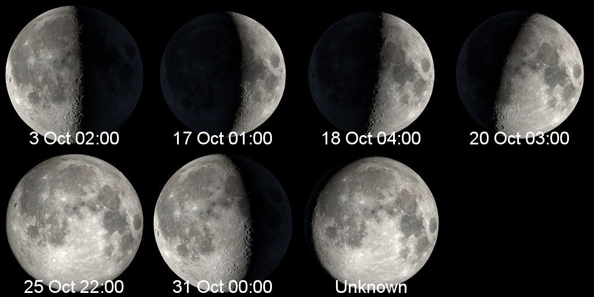
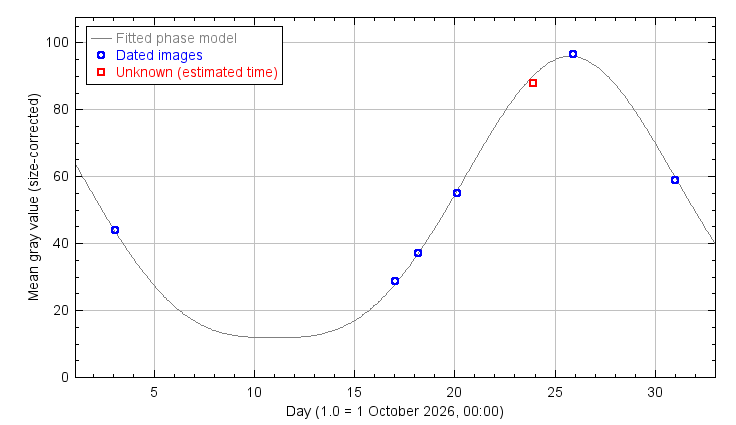

# Dating an Undated Moon Image with ImageJ

An ImageJ plugin that estimates when an undated Moon image was taken from six dated ones,
using the measured luminance, the apparent size of the disk and a pixel count of the sunlit
area.

> NEM 469 Project I, Hacettepe University, Department of Nuclear Engineering.

## Problem

Seven 730 × 730 px color images of the Moon: six carry a date and hour in their file names
(3 October 2026, 02:00 to 31 October 2026, 00:00) and one, `Unknown_Date.jpg`, has none. The
task was to date the seventh image from the luminance (ImageJ mean gray value) of all seven,
find the minimum number of dated images such an estimate needs, and automate it as a plugin.

<p align="center"></p>

## Method

| Step | What is done |
|:--|:--|
| Luminance | 8-bit weighted RGB conversion (Y = 0.299R + 0.587G + 0.114B), mean gray value over the whole frame |
| Size correction | Disk radius from a Kåsa least-squares circle fit to the sunlit limb; means scaled by (R<sub>ref</sub>/R)², R<sub>ref</sub> = 326.0 px |
| Luminance model | L(t) = a + b F(θ), Lambert-sphere phase law, synodic month P = 29.530589 d; a, b, t₀ fitted |
| Phase | Sunlit pixels (gray value ≥ 25) divided by πR², θ = arccos(1 − 2k); lit on the right means waxing |
| Date | Elongation of the undated image interpolated between the two dated images that bracket it |
| Checks | Leave-one-out test on the dated images, luminance-only estimates, NASA Dial-a-Moon data |

The fitted luminance curve is only used to pick the waxing or waning branch and the month. The
pixel count gives the phase itself, because it does not depend on how bright the sunlit surface
is rendered.

## Key Results

| Quantity | Value |
|:--|:--|
| Apparent radius over the month | 310.3 to 341.7 px (21% change in disk area) |
| RMS residual of the luminance fit | 0.852 gray levels |
| Undated image | 93.4% lit, lit on the right (waxing), elongation 150.1° |
| **Estimated time** | **23 October 2026, 21:43 ± 2.9 h UTC (about 10:00 PM)** |
| Leave-one-out RMS error | 5.6 h |
| Luminance only | 23 October 15:57 (fitted curve), 24 October 09:17 (straight line) |
| NASA Dial-a-Moon apparent diameter | about 22:00 UTC |
| Minimum number of dated images | 3 (three unknowns once P is fixed) |

<p align="center"></p>

Luminance alone placed the image anywhere between 23 October 15:57 and 24 October 09:17,
depending on how the curve was interpolated, because the curve flattens toward full Moon.
Without the 21% size correction the luminance curve could not be fitted at all.
The leave-one-out error is dominated by the one case where the interpolation had to span 11
days and the uniform-rate assumption breaks down. More dated images between 20 and 31 October
would shorten those gaps. The full analysis is in the [project report](docs/NEM469_Project1_Report.pdf).

## Running

1. Copy `Moon_Date_Estimator.ijm` to `Fiji.app/plugins` (or `ImageJ/plugins`) and restart.
2. Run **Plugins › Moon Date Estimator** and choose the `data/` folder.

Batch mode:

```bash
java -jar ij.jar -batch Moon_Date_Estimator.ijm "dir=C:/path/to/data/|year=2026"
```

File names must contain the day, month name and time (e.g. `3_October_02_00AM.jpg`), and the
undated image must have `Unknown` in its name.

## Repository Contents

| Path | Description |
|:--|:--|
| `Moon_Date_Estimator.ijm` | ImageJ macro plugin (the report appendix lists the same code without comments) |
| `data/` | The seven Moon images used in the project |
| `figures/` | Montage, lit-pixel mask of the undated image, luminance plot |
| `docs/NEM469_Project1_Report.pdf` | Project report |

The images came with the assignment; they match NASA Scientific Visualization Studio
Dial-a-Moon frames.

## Author

**Emre Sakarya**, Nuclear Engineering, Hacettepe University (Student ID: 2230386062).
